# Footwear Production Intelligence

Footwear Production Intelligence is a machine-learning application for weekly production forecasting and resource planning in a footwear manufacturing environment.

The project combines historical production data, predictive modeling, and prescriptive scenario analysis. Users can describe a production context, enter the planned weekly quantity and current resources, and receive:

- A predicted actual production quantity
- A comparison against the planned target
- A production status classification
- A recommended resource scenario
- A side-by-side comparison of current and proposed resources
- A downloadable file containing evaluated resource scenarios

## Application preview

### Production planning workspace

The Streamlit application guides the user through production context, weekly planning, and current resource inputs.

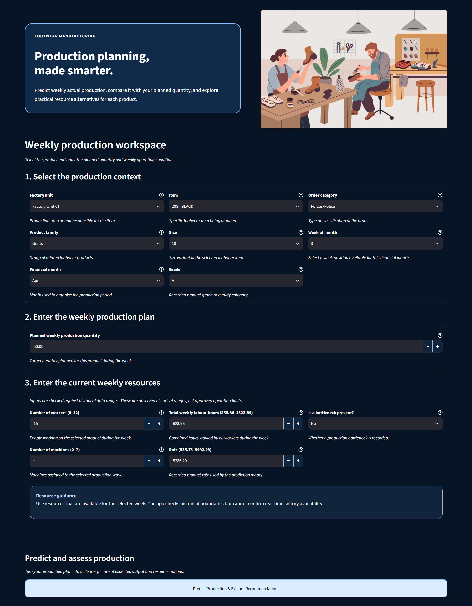

This screen collects the production context, planned quantity, and available resources used for forecasting.

### Prediction and resource recommendations

After prediction, the application presents the production decision, status, proposed resource changes, scenario comparison, and downloadable results.

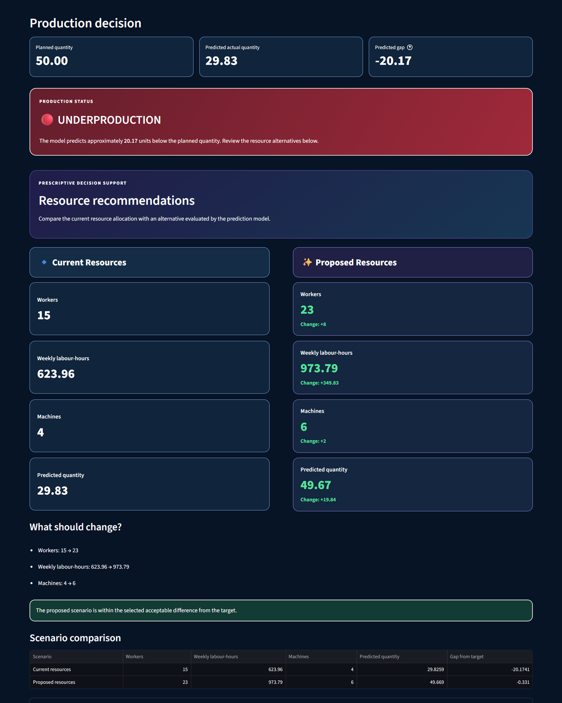

This view shows the forecast, production status, recommended resource changes, and scenario results.

## Analytical previews

The following figures are reproduced from the project notebooks and retained here as a compact visual record of the analytical workflow.

### Data preparation

The preprocessing workflow examines the `rate` distribution and applies the documented lower-tail IQR filter before saving the cleaned dataset.

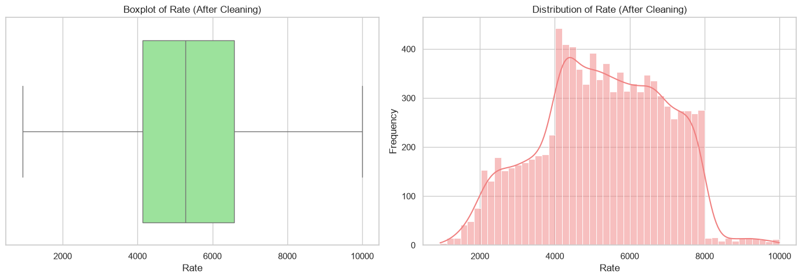

The chart shows the distribution of `rate` values after the lower-tail outlier filter has been applied.

### Exploratory analysis

The EDA phase examines the target distribution, time patterns, categorical production drivers, bottleneck differences, and numerical relationships.

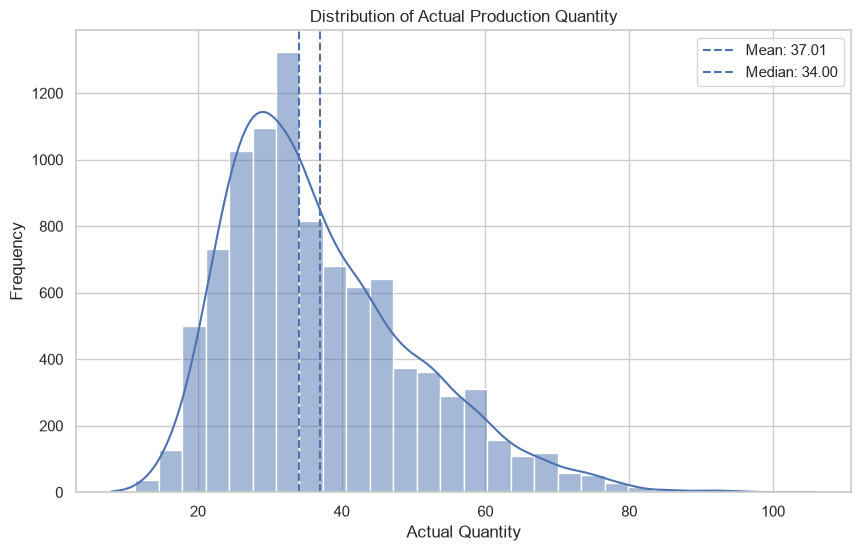

This distribution shows how weekly actual production quantities are spread across the dataset.

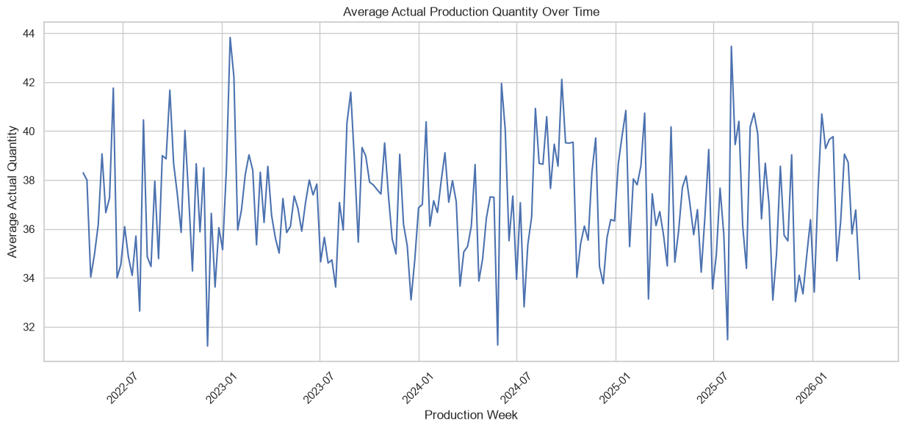

This trend highlights how production quantities changed over the observed production weeks.

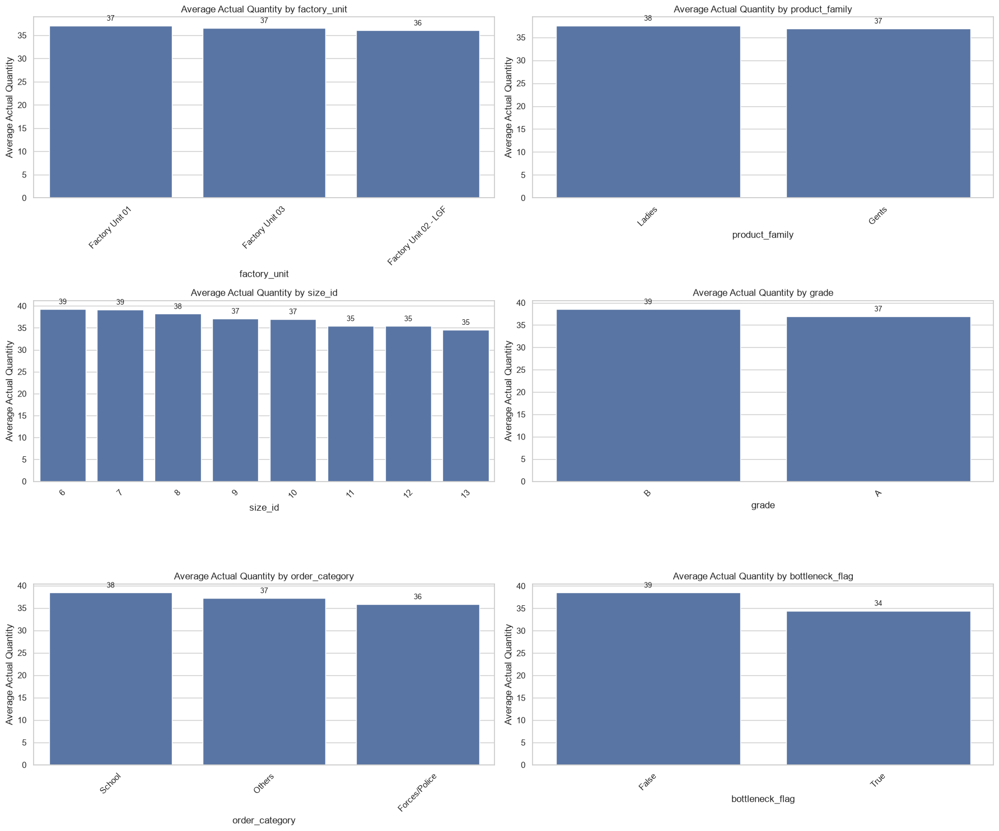

This comparison shows differences in average production across the main production categories.

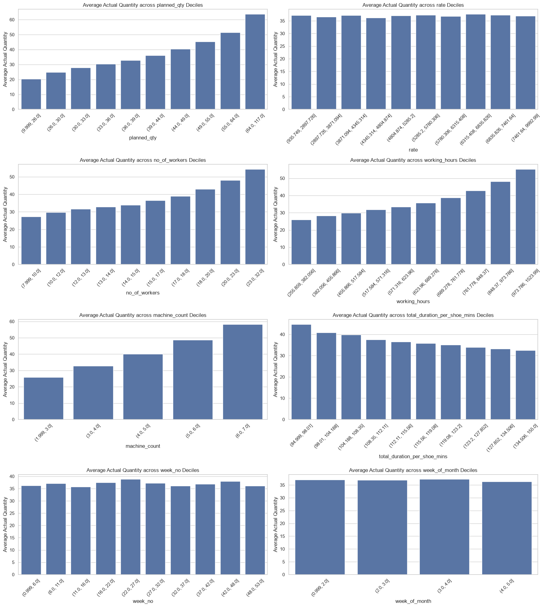

This chart compares production outcomes for records with and without a reported bottleneck.

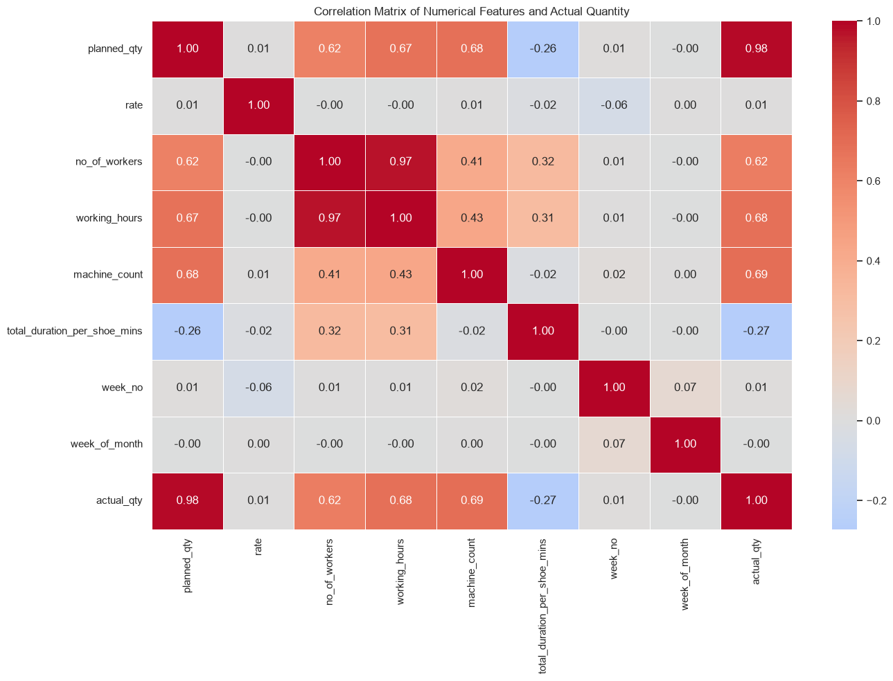

This correlation view summarises relationships between numerical production and resource variables.

### Model interpretation and evaluation

Model diagnostics include feature importance, held-out actual-versus-predicted values, and prediction-error analysis.

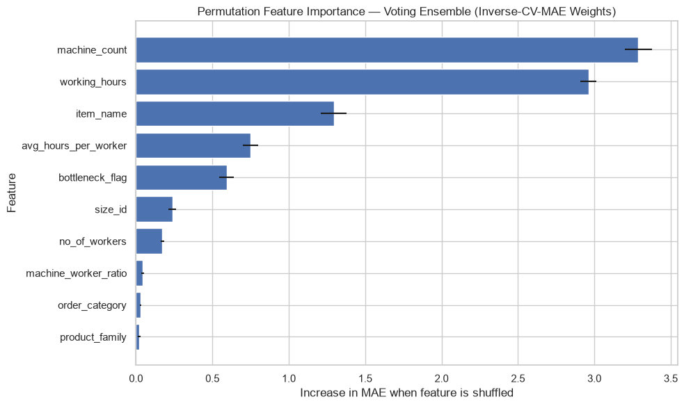

This plot ranks the input features by their contribution to the trained production model.

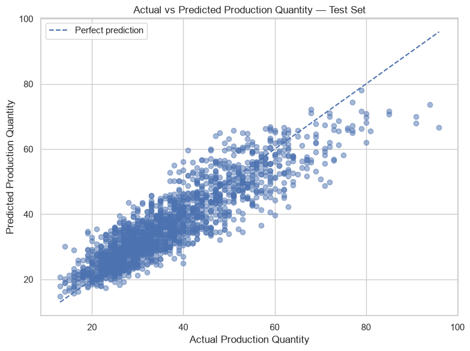

This comparison indicates how closely the model's predictions align with held-out actual quantities.

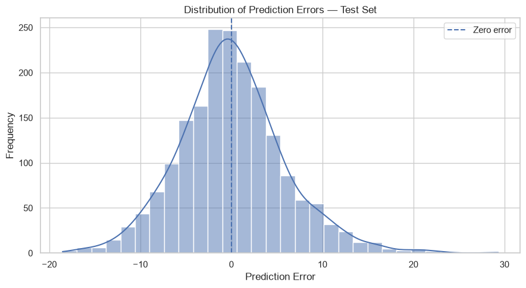

This analysis shows the size and pattern of the model's prediction errors.

### Prescriptive analysis

The prescriptive notebook evaluates candidate resource configurations and visualises the strongest scenarios relative to the planned quantity.

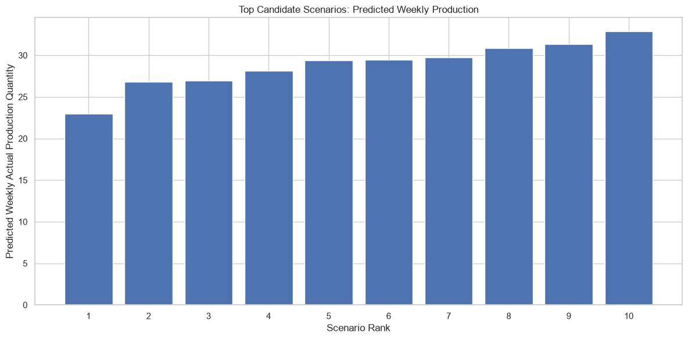

This chart compares candidate resource configurations and highlights scenarios near the planned target.

## Key capabilities

### Predictive production planning

The application predicts weekly `actual_qty` from information available before production, including:

- Financial month and week position
- Factory unit
- Product family and item
- Size and grade
- Order category
- Rate
- Number of workers
- Weekly labour-hours
- Machine count
- Bottleneck status

Two engineered resource features are also used by the trained pipeline:

- `machine_worker_ratio`
- `avg_hours_per_worker`

### Prescriptive resource analysis

The application evaluates alternative combinations of workers, weekly labour-hours, and machines. Candidate scenarios are ranked by:

1. Whether the scenario is within the configured target tolerance
2. Absolute distance from the planned quantity
3. A temporary resource-use tie-breaker

The resource-use value is only a numerical tie-breaker. It is not a validated cost or efficiency measure.

### Clear operational output

The result view includes:

- Planned quantity
- Predicted actual quantity
- Predicted gap
- Underproduction, overproduction, or within-tolerance status
- Current and proposed resource cards
- Colour-coded proposed changes
- Scenario comparison table
- CSV download of tested scenarios

## Project structure

```text
production-DI/
├── app.py
├── requirements.txt
├── README.md
|── app_preview.png
├── docs/
│   └── images/
│       ├── app_preview_overview.png
│       ├── app_preview_recommendations.png
│       ├── preprocessing_rate_after.png
│       ├── eda_actual_distribution.png
│       ├── eda_weekly_trend.png
│       ├── eda_category_comparison.png
│       ├── eda_bottleneck_comparison.png
│       ├── eda_correlation.png
│       ├── model_feature_importance.png
│       ├── evaluation_actual_vs_predicted.png
│       ├── evaluation_error_analysis.png
│       └── prescriptive_scenarios.png
├── assets/
│   ├── image1.png
│   └── image2.png
├── data/
│   ├── raw/
│   │   └── DI_Leather_weekly_dataset.csv
│   └── processed/
│       ├── DI_Leather_preprocessed.csv
│       └── final_features.csv
├── models/
│   ├── production_model.joblib
│   └── production_model_evaluation.joblib
├── notebooks/
│   ├── 01_Data_Preprocessing.ipynb
│   ├── 02_Exploratory_Data_Analysis.ipynb
│   ├── 03_Feature_Engineering.ipynb
│   ├── 04_Model_Development_and_Training.ipynb
│   ├── 05_Prediction_Performance_Evaluation.ipynb
│   ├── 06_Prescriptive_Feature_Engineering.ipynb
│   └── outputs/
└── reports/
    ├── DI_Leather_Phase_2_Prescriptive_Analytics_Roadmap.docx
    └── DI_Leather_Updated_Research_Proposal.docx
```

## Technical workflow

### 1. Notebook 01 — Data preprocessing

The preprocessing notebook prepares the raw weekly production data for analysis and modeling. It:

- Loads and inspects the raw CSV
- Checks exact duplicates and missing values
- Converts date and Boolean fields to consistent types
- Creates the consolidated `order_category` feature from order indicators
- Removes identifiers, redundant fields, and pre-calculated outcome variables
- Detects lower outliers in `rate` using the IQR rule
- Saves `data/processed/DI_Leather_preprocessed.csv`

Only lower `rate` outliers below the calculated lower IQR boundary are filtered. Upper values are retained. The notebook explicitly treats statistical outliers as observations requiring contextual review rather than automatically invalid records.

### 2. Notebook 02 — Exploratory data analysis

The EDA notebook analyses the cleaned dataset before feature engineering. It documents:

- Dataset structure, data types, missingness, duplicates, constants, and validity checks
- Target distribution, percentiles, skewness, kurtosis, normality assessment, and log-transformation check
- Weekly, monthly, yearly, week-number, and week-of-month patterns
- Average production by factory unit, product family, size, grade, order category, and bottleneck status
- Item-level frequency and production summaries with a minimum-observation comparison
- Numerical feature deciles, correlations, multicollinearity, and linear/nonlinear relationships

The notebook covers 9,495 preprocessed records, 22 columns, and approximately 207 production weeks from April 2022 to March 2026. Its findings are exploratory associations, not causal claims.

### 3. Notebook 03 — Feature engineering and dataset preparation

The feature-engineering notebook sorts records chronologically, creates:

- `machine_worker_ratio = machine_count / no_of_workers`
- `avg_hours_per_worker = working_hours / no_of_workers`

It validates the engineered values, reviews `bottleneck_flag`, removes columns that should not enter the model, confirms the final 16-feature input set, and saves `data/processed/final_features.csv`. Target-derived fields such as `actual_qty`, production gaps, achievement measures, and other post-production metrics are excluded from model inputs.

### 4. Notebook 04 — Model development, evaluation, and selection

The model-development notebook:

- Recreates the chronological train/test design
- Builds a shared preprocessing pipeline for numerical, low-cardinality categorical, high-cardinality `item_name`, and binary features
- Tunes and compares multiple regression candidates
- Uses time-aware cross-validation and a multi-metric ranking based on CV MAE, CV RMSE, and CV R²
- Builds a Voting Regressor ensemble from the strongest individual candidates
- Runs residual diagnostics and feature-importance analysis
- Retrains the selected pipeline on all available records and saves `models/production_model.joblib`

The reports identify the selected model as a Voting Ensemble combining MLP Regressor, XGBoost, and SVR. The saved all-records model is the deployment artifact; its in-sample predictions must not be presented as independent test performance.

### 5. Notebook 05 — Prediction performance evaluation

The prediction notebook reloads the saved model and processed features, reproduces the chronological split, evaluates the held-out test period, and exports prediction results. It includes:

- Actual-versus-predicted production analysis
- Error and residual analysis
- A reproducible single-record prediction demonstration
- Export of prediction outputs for review

### 6. Notebook 06 — Prescriptive optimisation prototype

The prescriptive notebook uses the saved prediction pipeline inside a transparent candidate-search loop. It:

1. Establishes a baseline product and resource scenario.
2. Accepts a planned production quantity as a comparison target.
3. Generates feasible historical levels for workers, hours, and machines.
4. Recalculates engineered ratios for every candidate.
5. Predicts each candidate with the saved model.
6. Calculates target gaps and resource-use proxy values.
7. Ranks and validates candidate scenarios.
8. Compares candidates with the baseline and exports results.

The dashboard implements this prototype using exhaustive enumeration. It is not a causal model and is not a fully cost-optimised production scheduler.

## Model performance reference

The project reports the following held-out test-set results for the selected Voting Ensemble:

| Metric | Reported value |
|---|---:|
| R² | 0.801 |
| MAE | 4.436 units |
| RMSE | 5.842 units |

These are held-out chronological evaluation results reported in the Phase 2 roadmap and should be revalidated if the dataset, feature definitions, preprocessing, or model artifact changes.

## Installation

### Requirements

- Python 3.10 or newer
- A working virtual environment
- The packages listed in `requirements.txt`

### Setup on Windows

From the project directory:

```powershell
py -m venv .venv
.\.venv\Scripts\Activate.ps1
python -m pip install --upgrade pip
python -m pip install -r requirements.txt
```

If PowerShell prevents script activation, run the Streamlit command through the virtual-environment executable directly:

```powershell
.\.venv\Scripts\python.exe -m streamlit run app.py
```

## Run the application

```powershell
streamlit run app.py
```

The application expects these files to exist relative to `app.py`:

- `models/production_model.joblib`
- `data/processed/final_features.csv`
- `assets/image1.png`
- `assets/image2.png`

If the model or processed dataset is missing, the application stops and displays an actionable error message.

## Reproduce the analytical workflow

Run the notebooks in the following order:

1. `01_Data_Preprocessing.ipynb`
2. `02_Exploratory_Data_Analysis.ipynb`
3. `03_Feature_Engineering.ipynb`
4. `04_Model_Development_and_Training.ipynb`
5. `05_Prediction_Performance_Evaluation.ipynb`
6. `06_Prescriptive_Feature_Engineering.ipynb`

The notebooks generate intermediate datasets, evaluation outputs, model artifacts, charts, and prescriptive scenario results.

## Input validation and interpretation

The application validates numeric inputs against observed historical ranges. These ranges are data boundaries, not approved factory operating limits.

Before acting on a recommendation, production teams should verify:

- Worker availability
- Machine availability
- Shift and labour-hour limits
- Order deadlines
- Quality requirements
- Bottleneck conditions
- Actual operating costs

A model prediction is an estimate based on historical data and is not a guarantee of production output.

## Data and model governance

- Do not expose raw production data or trained model artifacts outside approved project storage.
- Re-train and evaluate the model when production processes or product mix change materially.
- Track changes to feature definitions and preprocessing logic.
- Validate recommended scenarios with production stakeholders before implementation.
- Treat the temporary resource-use proxy as a ranking aid, not as a financial calculation.

## License and project context

This repository was developed as a production analytics project for the DI Leather footwear manufacturing context. Add the organisation's approved licence, data-use policy, and contribution guidelines before external distribution.
